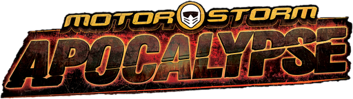

<p align="center">
  
</p>

# MotorStorm: Apocalypse on PC, by static recompilation

A native Windows port of **MotorStorm: Apocalypse** (PS3, BCES00484 v02.00). The game's PowerPC
code is translated to C++ with [ps3recomp](https://github.com/sp00nznet/ps3recomp), then compiled
with a runtime that stands in for the console (Direct3D 12, sound, controller, local network).

**This repository contains neither the game nor the firmware.** It only holds our own work: the
port's sources, the launcher, the scripts and our changes to ps3recomp. You need your own disc of
the game and the firmware of your own console to use it.

## Status (25 November 2026)

- The game boots, the menus work, and races run to the end with a correct picture on the two
  tracks tried so far (the bridge and the pier).
- A steady 30 frames per second (the game's own cap) on an i7-10700F and an RTX 4070 SUPER.
- Renders at 720p by default; true 1080p and 1440p are available (`PORT_RES=1920x1080`).
- Sound and music work. Movies are replaced by a short clip.
- Multiplayer on a local network with no server, using the LAN mode the game already contains;
  tried with two and three instances on one machine, not yet between two PCs.
- Known defect: dark squares around the vehicles.

## What is in the repository

| Folder | Contents |
|---|---|
| [port/](port/) | the port's CMake project: `main.cpp`, answers to the console's libraries (`hle_overrides.cpp`), network (`net_hooks.cpp`), build and run scripts |
| [launcher/](launcher/) | `Lanceur.exe` (Tauri 2): settings, LAN games, starting the game from its own folder |
| [scripts/](scripts/) | translating the game (`lift_title.py`), measurements, captures, debugging tools; each script says what it does in its header |
| [toolkit/](toolkit/) | our changes to ps3recomp: a diff to apply on the commit named in `BASE.txt`, plus the files we added |

What is not here, and never will be: the decrypted `EBOOT`, the translated code (`work/`), the
SPU images, extracted or modified game files, firmware files, the compiled exe.

## What you need to rebuild it

- Windows 10 or 11, 64-bit, a Direct3D 12 graphics card, a CPU with AVX2 and FMA.
- Visual Studio with clang-cl, CMake, Ninja, Python 3; Rust and WebView2 for the launcher.
- The game disc (BCES00484, v02.00), copied to the PC.
- [RPCS3](https://rpcs3.net/) to decrypt `EBOOT.BIN`, and the PS3 firmware (`libsre.prx`,
  `dev_flash`).

The folders are expected side by side:

```
Recomp\
├── ps3recomp\     the toolkit, with our changes
├── .venv\         the Python environment of the tools
├── tools\rpcs3\   RPCS3 portable
└── MotorStorm\    this repository
```

The steps, in order:

1. **The toolkit**: clone ps3recomp, check out the commit named in
   [toolkit/BASE.txt](toolkit/BASE.txt), `git apply` `toolkit\ps3recomp_local.diff`, then copy
   `toolkit\new_files\` over it.
2. **The game**: decrypt `EBOOT.BIN` (`rpcs3.exe --decrypt`) and put the result in
   `game\BCES00484\`.
3. **The translation**: `python scripts\lift_title.py BCES00484 --spu`, then
   `python scripts\func_hooks.py`. The full procedure (firmware, SPU modules, order of the
   steps) is in `.claude\skills\ps3-lift\SKILL.md`.
4. **The build**: `port\build.bat configure`, then `port\build.bat` (about twenty minutes for a
   full build).
5. **Running it**: `port\run.bat` (development), or the player's folder with the launcher
   (`launcher\build.bat`, then `scripts\deploy_game.ps1`).

Many scripts and the `.bat` files still carry the paths of the machine the project was born on
(`I:\Projets\Recomp`, `F:\Jeux\PS3`, `E:\ms_perf`): adapt them to yours.

## Credits

- [ps3recomp](https://github.com/sp00nznet/ps3recomp) (Ned Heller / sp00nznet, MIT): the
  recompilation toolkit and its runtime.
- [motorstorm-apocalypse-pc](https://github.com/millennium-h4x0r/motorstorm-apocalypse-pc)
  (MIT): another port of the same game, where the local-register lifter comes from.
- [RPCS3](https://rpcs3.net/): decryption and behaviour reference.

What we took from them is listed in [toolkit/NOTICE.md](toolkit/NOTICE.md).

## License

Our code is under the MIT License ([LICENSE](LICENSE)). The project's working notes (journal,
per-topic docs) are not published: code comments that point to `docs\` or `CLAUDE.md` refer to
them.

MotorStorm and the MotorStorm: Apocalypse logo are trademarks of Sony Interactive Entertainment;
the logo is shown here only to identify the game and is not covered by the MIT License. This
project is not affiliated with Sony or Evolution Studios.
